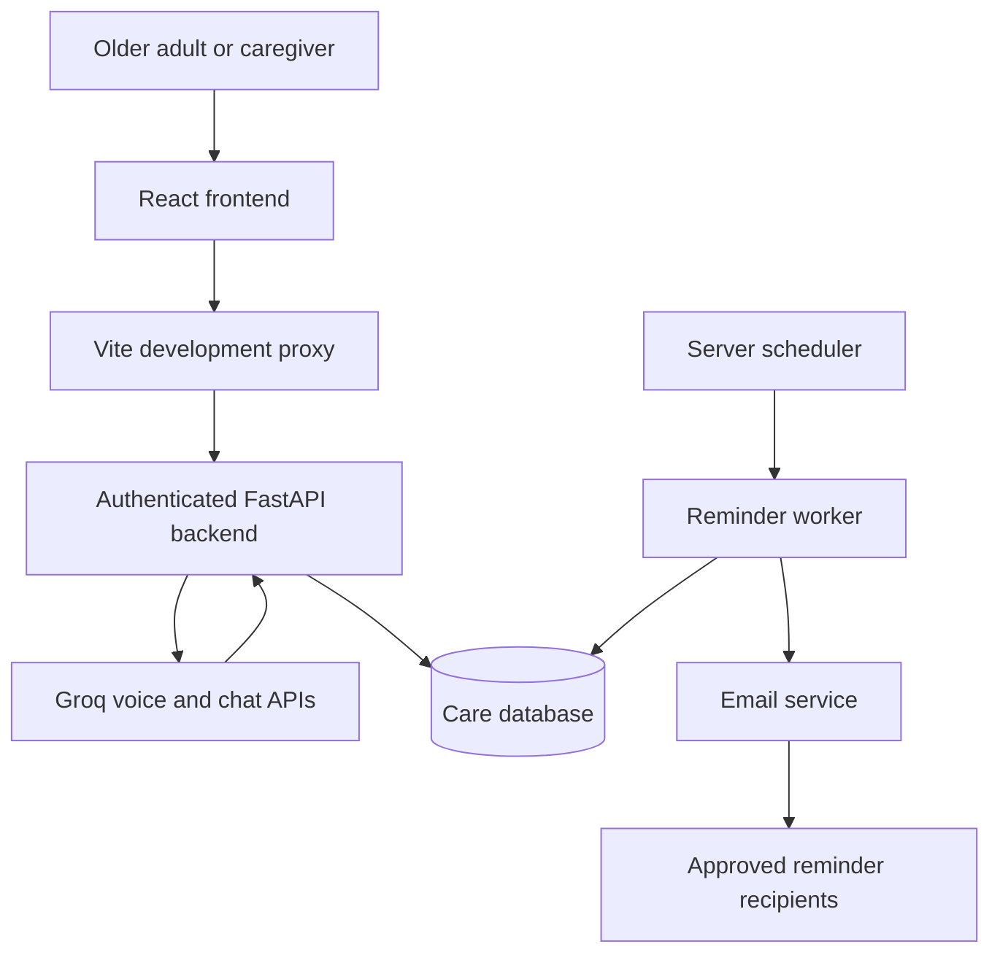

# CareCircle

A voice-assisted medication and appointment workspace for older adults and the people they authorize to help.

**Chosen challenge vertical — Elderly Care & Medication Management**

**Current status — local application implemented.** CareCircle uses a React and GSAP frontend, a FastAPI backend, SQLite, and a separate reminder worker. The frontend is served by Vite during development. Email delivery and voice features depend on local configuration; production deployment and a full accessibility audit are not yet verified.

## Start locally

Requirements: Python 3.12 or newer, Node.js 18 or newer, and npm. Run these commands from the repository root with the Python virtual environment activated:

```powershell
python -m pip install -r requirements.txt
cd web
npm install
cd ..
python -m backend.seed_demo
python run.py
```

Open **http://localhost:5173**. The API documentation is at **http://localhost:8000/docs**. `run.py` starts the API, reminder worker, and React development server together. The Vite development proxy forwards `/api` requests to FastAPI.

The demo seeder creates fictional older-adult and caregiver accounts, three sample medication records, and an appointment. It prints a generated passcode shared by both demo accounts. If the demo accounts already exist and their passcode is unknown, run `python -m backend.seed_demo --reset-passcodes`; this resets only those demo passcodes and revokes their active sessions.

Ports are configurable with `API_HOST`, `API_PORT`, `FRONTEND_HOST`, and `FRONTEND_PORT` in a local `.env` file. For example, set `API_PORT=8001` if port 8000 is unavailable; the Vite proxy uses the same setting. Email defaults to preview mode. A Groq API key is needed for audio transcription and spoken replies; text questions can use the local intent fallback.

Before using a Groq credential, configure your own key in a local `.env`; do not commit credentials. Demo `.test` addresses cannot receive real email. Do not use the fictional demo accounts in a deployed environment.

## 1. Product purpose

CareCircle helps an older adult understand their daily care schedule, record medication activity, and request support through a shared care profile. Family members and caretakers can help maintain that profile and coordinate follow-up with the older adult's permission.

The central experience combines three actions.

1. **Understand today.** See or hear upcoming medication doses and appointments.
2. **Record what happened.** Confirm a specific dose, record a skip, or correct an earlier entry.
3. **Get support.** Request a check-in and see which authorized person has acknowledged it.

Voice interaction reduces typing for common daily actions. The same actions remain available through large, clearly labeled controls.

## 2. Requirements and proposed additions

The following requirements come from the supplied challenge statement and submission rules.

| Required outcome | Planned implementation |
| --- | --- |
| Shared healthcare profile | A persistent care profile accessible to authorized older adults, family members, and caretakers |
| Secure, passcode-based access | Individual passcode sign-in, expiring invitations, and server-enforced profile permissions |
| Medication schedule management | View, add, edit, and deactivate recurring medication schedules |
| Adherence tracking | Separate records for each scheduled dose, including confirmation and correction history |
| Appointment management | View, create, edit, and cancel doctor appointments |
| Proactive email reminders | Scheduled processing for upcoming doses, missed or unconfirmed doses, and appointments |
| Context-aware assistant | Decisions based on authenticated profile, time, schedule, dose status, and sharing preferences |
| Older adult at the centre | Explicit sharing choices, control over care-circle membership, and confirmation before voice changes |
| Accessible, practical experience | Readable daily view, keyboard support, large controls, and voice assistance |
| Public repository and README | Complete source, setup instructions, design logic, assumptions, and verification results in one public repository |
| Single-branch workflow | Implementation, commits, and pushes on one branch |

Individual accounts, invitation expiry, follow-up ownership, and voice assistance are proposed design choices. The challenge does not specify their exact implementation. Voice assistance was added to this project's scope during planning.

The supplied evaluation material names code quality, security, efficiency, testing, accessibility, and problem alignment. It does not assign individual features to impact tiers or provide numerical weights.

## 3. Personas and permissions

| Persona | Intended experience | Authority |
| --- | --- | --- |
| Older adult / profile owner | Simple daily view and voice assistance | Manage their care records, invite members, assign permissions, choose reminder recipients, and revoke access |
| Family member or caretaker with editing access | Shared schedule and follow-up view | Manage medication schedules and appointments, record dose activity, and respond to follow-up requests |
| Family member or caretaker with viewing access | Read-only care overview | View the authorized profile and its history |

Family relationship and access permission are stored separately. A family member receives the permission explicitly assigned by the profile owner.

For the initial version, the older adult creates or participates in creating the owner account. Assisted onboarding lets a helper enter information with the older adult present. Formal guardianship and delegated account ownership require a later design.

Revoking a membership takes effect on the next protected request and removes that member from future reminder recipients. Every protected operation checks active membership on the server.

## 4. Main user journeys

### Create and share a care profile

1. The owner creates an account with a sign-in identifier and personal passcode.
2. They enter their display name, time zone, reminder email, and preferences.
3. They generate an expiring, single-use invitation with a chosen permission.
4. The invited person redeems the invitation and creates their own sign-in credentials.
5. The owner sees the member in the care circle and can change or revoke access.

Invitation redemption must be atomic so concurrent attempts cannot create multiple memberships from one invitation.

### Manage a medication schedule

An authorized editor enters the medication name, prescribed dose text, optional instructions, local administration times, start date, and optional end date. The initial recurrence model supports daily schedules with one or more times.

Each occurrence gets its own dose record. Updating a schedule affects future pending occurrences from an explicit effective time. Existing taken, skipped, and historical records retain the schedule details that applied when they were created.

Deactivating a medication cancels future pending occurrences and queued reminders. Schedule changes are recorded with the actor and timestamp.

### Record a dose

The older adult or authorized editor selects a particular occurrence and records Taken or Skipped. A skip may include an optional reason. Corrections preserve the previous value in the activity history.

An overdue occurrence with no report is displayed as **Unconfirmed**. The system knows that confirmation is missing. Its missed-dose reminder explains that distinction to the recipient.

### Coordinate a check-in

1. An unconfirmed dose passes the configured follow-up threshold, or the older adult requests help.
2. If sharing is enabled and an eligible contact is selected, a follow-up request is created.
3. An authorized editor can acknowledge responsibility using **I'll check in**.
4. The shared view shows the person responsible and the acknowledgement time.
5. That person records an outcome such as Contacted, Unable to reach, or Help requested.

Follow-up acknowledgement and dose confirmation are separate operations. Resolving a check-in leaves dose status governed by its own record. The system presents existing open requests before creating another request about the same dose.

### Manage an appointment

An authorized editor enters the doctor or clinic, date and time, location, and optional preparation notes. The appointment appears in the daily view and the appointment list. Editing or cancelling it invalidates outdated queued reminders.

## 5. Voice assistant design

The first version targets **record-and-submit voice interaction with spoken responses**. The user records a short message in the React frontend, which converts the browser recording to WAV before sending it to the FastAPI backend. The recognized words and response remain visible. English is the initial language; additional languages require recognition and usability testing.

| Example utterance | Intended response |
| --- | --- |
| What medicines are due today? | Read today's saved dose schedule and show the matching cards |
| What is next? | Describe the next relevant pending dose or appointment |
| I took my morning medicine | Resolve the intended occurrence, clarify ambiguity, and request confirmation |
| When is my next appointment? | Read the next saved appointment |
| Ask my daughter to check in | Resolve an authorized contact and confirm the request before sending |
| Repeat that | Repeat the last response |
| Cancel | Discard the pending voice action |

Example interaction using fictional records follows.

> **User** — I took my medicine.
>
> **Assistant** — You have two medicines scheduled this morning. Which one did you take?
>
> **User** — Medicine A.
>
> **Assistant** — Record today's 8 AM dose of Medicine A as taken?
>
> **User** — Yes.

The action is persisted only after confirmation. The server rechecks permission and current dose state before accepting it. An expired, changed, ambiguous, or unsupported action produces a clarification or a visible choice.

Groq Whisper transcribes the recording through the FastAPI backend. A Groq chat model proposes an intent from a bounded set of supported actions. Pydantic schemas and server-side checks validate the result, and authorized database queries supply care information. Medication changes remain explicit schedule-editing actions entered by authorized people from their care instructions. Exact model availability and account limits require verification. [Groq speech recognition](https://console.groq.com/docs/speech-to-text)

The speech-output path uses Groq text-to-speech through the backend and the browser audio player. Recorded speech and response text are processed by Groq. Browser microphone permission, recording, playback, network failures, and recognition accuracy require further testing. Touch controls and visible response text remain available. [Groq speech output](https://console.groq.com/docs/text-to-speech/)

The backend binds pending confirmations to the authenticated session, profile, exact action, and record revision, with a short expiry. Confirmation writes are validated against authorized records before execution; the frontend only submits an action after the user confirms it.

Application storage should retain confirmed care actions and their audit entries. Raw microphone recordings and free-form transcripts are unnecessary for this initial workflow and should be discarded after processing. Speech-provider handling remains subject to the selected recognition service.

Live video calling and an animated video assistant are future options. The agreed initial design focuses on voice interaction.

## 6. Context and decision logic

| Situation | Planned decision | Explanation visible to the user |
| --- | --- | --- |
| Pending dose enters its reminder window | Queue an upcoming-dose email | This dose is scheduled soon |
| Dose is recorded as taken or skipped | Suppress subsequent automatic dose reminders | The occurrence already has a recorded outcome |
| Dose remains unconfirmed past its grace period | Queue a missed-dose email and show Unconfirmed | Confirmation has not been recorded |
| Follow-up threshold passes with consent enabled | Create one request and notify the selected eligible contact | Your sharing preference allows this check-in |
| A caregiver acknowledges the request | Show follow-up ownership | This person is checking in |
| Appointment enters its reminder window | Queue an appointment email | This appointment is approaching |
| Voice request matches several records | Ask the user to choose | More than one record matches |
| Access or consent is revoked | Reject access and suppress affected queued notifications | The current permission no longer authorizes this action |

An optional later enhancement can summarize recurring unconfirmed doses using explicit counts and a stated date range. For example, it may offer a consent-based evening check-in after several unconfirmed evening occurrences. This is an extension after the core workflow is verified.

## 7. Interface and visual design

The proposed visual direction uses a warm off-white background, dark text, restrained teal accents, and clear spacing. Typography uses Atkinson Hyperlegible Next with system-font fallbacks. Contrast must be measured during implementation.

### Older adult home

- A heading with the person's name and today's date in the profile time zone.
- A prominent Talk to CareCircle control with Listening, Processing, and Stopped states.
- The next care item with its name, time, saved instructions, and primary action.
- Today's remaining doses and appointments in chronological order.
- Large Taken, Skip, and Ask for help controls where applicable.
- A visible status for any open check-in request.

### Caregiver home

- The selected care profile and permission level.
- Unconfirmed doses and open check-ins ordered by age.
- Who has acknowledged each follow-up request.
- Medication and appointment editing controls for authorized editors.
- Recent care activity with actor names and timestamps.

### Shared navigation

The React app provides Today, Medications, Appointments, Care Circle, and History. Reminder preferences and consent controls are under Care Circle. Time zone is selected during profile creation; a dedicated accessibility-settings page is not implemented.

### Accessibility acceptance targets

- Primary touch controls at least 48 by 48 CSS pixels.
- Readable text, with approximately 18 CSS pixels as the daily-view starting size.
- Text labels accompany icons and status colors.
- Logical keyboard navigation, visible focus, and labeled form fields.
- Status updates announced through appropriate accessible live regions.
- Usable layouts at narrow mobile widths and 200% zoom.
- Voice replies also shown as text, with a stop-speaking control.
- Errors explain how to recover and preserve valid form entries.
- No automatic microphone activation or automatic spoken playback on page load.

These are design targets to verify through browser testing and accessibility checks.

## 8. Selected stack and proposed architecture

The implementation uses **React and GSAP for the frontend**, **Vite for local development**, and **FastAPI for the backend**, with **Groq for optional voice transcription, assistant interpretation, and speech output**. React provides role-aware screens and accessible forms; FastAPI owns authentication, permissions, care rules, database access, and external-service credentials.

| Component | Proposed responsibility |
| --- | --- |
| FastAPI and Uvicorn | API routes, authenticated requests, profile permissions, and care actions |
| Pydantic | Request validation and validation of proposed assistant actions |
| React, Vite, and GSAP | Role-aware screens, forms, audio capture, status displays, and restrained page transitions |
| Groq | Whisper transcription, chat-based intent interpretation, and proposed speech output |
| Python SQLite | Profiles, memberships, schedules, occurrences, appointments, history, and reminder queue |
| Dedicated Python reminder worker | Periodic due-item evaluation and queued-email processing |
| Python SMTP email adapter | Configured delivery with recorded attempts and failures |
| unittest and FastAPI TestClient | API, care-rule, authorization, and reminder tests |

FastAPI authentication dependencies resolve the current account from an expiring bearer session token. The randomly generated token is stored as a hash in the database and revoked on logout. Profile permissions and throttling are explicit application logic. [FastAPI security](https://fastapi.tiangolo.com/tutorial/security/)

The React frontend sends all care reads and writes to FastAPI through the `/api` route. In development, Vite proxies that route to the API. The bearer token is held in tab-scoped session storage and revoked on logout. GROQ_API_KEY and SMTP credentials belong in local environment configuration, never frontend source.

The reminder worker runs as a separately supervised process, sharing backend care logic and the database. A deployment must run the frontend, API, and reminder worker with appropriate connectivity.



SQLite is the selected database for local development. The API and one reminder worker share the same database path. Production requires a persistent storage volume and a same-origin reverse proxy that routes `/api` requests to FastAPI; the Vite proxy is for development only.

Enable foreign-key checks and a bounded busy timeout on each connection, use short write transactions, and test WAL mode for concurrent reads and writes. Keep external Groq and email requests outside database write transactions. SQLite permits one writer at a time, and WAL requires database-accessing processes on the same host. This design targets a quick single-server launch. Supported traffic must be established by testing. [SQLite deployment guidance](https://www.sqlite.org/whentouse.html), [SQLite WAL documentation](https://www.sqlite.org/wal.html)

Keep the database directory on a persistent local volume across restarts and deployments, and use SQLite's backup API for consistent backups. Database migrations, simultaneous API and reminder writes, and restart persistence must be verified before release.

## 9. Data model

| Entity | Key information and constraints |
| --- | --- |
| Account | Unique sign-in identifier, display name, hashed passcode, session identity |
| AuthSession | Account, hashed bearer token, expiry, revocation time |
| CareProfile | Owner, display name, time zone, reminder preferences |
| Membership | Profile, account, permission, active status; unique profile-account pair |
| Invitation | Profile, hashed token, assigned permission, expiry, redemption status |
| Medication | Profile, name, prescribed dose text, instructions, active status |
| ScheduleVersion | Medication, local times, date range, effective time, revision |
| DoseOccurrence | Schedule version, due time in UTC, local-date context, snapshot of instructions, status, recorded actor and time |
| Appointment | Profile, doctor, location, scheduled UTC time, preparation notes, revision, cancellation state |
| FollowUp | Profile, optional dose reference, requester, assigned contact, acknowledgement, outcome, resolution time |
| Notification | Event reference, event revision, recipient, type, due time, state, attempt count, next retry, safe error summary |
| ActivityEvent | Profile, actor, action, entity reference, previous and updated values, timestamp |

Unique constraints prevent duplicate dose occurrences and duplicate notifications for the same event revision, recipient, and notification type. Follow-up creation uses a transaction to avoid multiple open requests for one dose. Conditional updates prevent conflicting caregiver claims from silently overwriting one another.

Store timestamps in UTC and interpret recurrence using the profile's named time zone. Schedule changes preserve completed history. Daylight-saving transitions require explicit tests for nonexistent and repeated local times before those zones are advertised as supported.

## 10. Reminder reliability

Reminders run on a server scheduler while the browser is closed. A proposed one-minute processing interval is an operational target, dependent on hosting support.

Each processing cycle performs these steps.

1. Materialize a bounded window of upcoming dose occurrences using unique occurrence keys.
2. Evaluate due events against current care records and reminder preferences.
3. Create notification records transactionally with unique event keys.
4. Claim eligible queued notifications so concurrent workers cannot normally send the same record.
5. Recheck dose or appointment state, recipient membership, and consent immediately before sending.
6. Attempt delivery with a finite timeout, then record provider acceptance or an error.
7. Retry eligible temporary failures with bounded backoff and expose exhausted failures to the profile owner.

Use bounded batches and indexed due-time fields. Persist worker leases and a heartbeat so interrupted work can be recovered and stalled processing can be detected.

Upcoming-dose emails expire when the dose becomes due. Missed-dose alerts apply to unconfirmed occurrences within a documented catch-up window. Proposed defaults are 15 minutes before a dose, 30 minutes after an unconfirmed dose, 60 minutes for an optional caregiver follow-up, and 24 hours before an appointment. A newly created appointment inside that window receives one upcoming reminder while still in the future. These are product assumptions, configurable and subject to testing.

The initial catch-up window is proposed as 24 hours. Older unconfirmed occurrences remain visible in history. Recovery after an outage should consolidate overdue alerts by profile and recipient to avoid an email burst.

Routine duplicate prevention is testable. An SMTP timeout after server acceptance can still leave an uncertain delivery outcome, and a dose may be confirmed while an email is already being transmitted. Record these limitations and recheck state on retries. Provider acceptance is distinct from confirmed inbox delivery.

Email subjects should contain minimal health information. The email body explains the event and links to the authenticated application. Message detail follows the owner's sharing preference.

## 11. Security and consent

- Hash personal passcodes with salted scrypt. Passcodes are at least eight characters; this does not replace a production security review.
- Apply persistent attempt throttling by account and request source, with bounded cooldowns and generic authentication errors.
- Generate high-entropy, expiring invitation tokens, store their hashes, and consume them once.
- Enforce profile membership and operation permissions on every protected server endpoint, including voice actions.
- Use HTTPS for browser and API connections, expiring bearer sessions for backend requests, and a same-origin reverse proxy in production. Validate inputs and render user content as text.
- Store secrets in environment configuration and commit only a placeholder configuration example.
- Check current consent and membership before dispatching a queued caregiver notification.
- Avoid logging passcodes, invitation tokens, microphone recordings, and sensitive email bodies.
- Record schedule changes, membership changes, consent changes, dose corrections, and follow-up actions.
- Use fictional data for demonstrations and automated tests.

Account recovery remains an implementation decision. Before supporting real accounts, define and test a recovery flow that verifies ownership and invalidates recovery credentials after use.

## 12. Validation plan

The backend workflow suite and frontend production build are run as part of local verification. Accessibility and deployment checks still require manual validation.

| Area | Required verification |
| --- | --- |
| Authentication | Correct and incorrect passcodes, cooldown behavior, expired invitations, concurrent invitation redemption, token expiry, and logout revocation |
| Authorization | Another profile's records remain inaccessible through direct URLs and voice endpoints; revoked members lose access |
| Medication schedules | Multiple daily times, date boundaries, effective edits, deactivation, and historical-record preservation |
| Dose tracking | Repeated confirmation is idempotent; corrections are auditable; concurrent changes remain consistent |
| Reminders | Upcoming, missed, and appointment events; retries; duplicate job execution; cancellation; consent revocation; outage recovery |
| Email | Development outbox inspection and a separately authorized real delivery test using configured credentials |
| Follow-up | One open request per dose, concurrent acknowledgements, clear outcome history, and independent dose state |
| Voice | Recognized commands, ambiguity, cancel, microphone denial, Groq failures, stale confirmations, and duplicate submissions |
| Accessibility | Keyboard-only journey, labels, contrast, zoom, narrow layout, focus behavior, and status announcements |
| Time handling | Profile-zone conversion, midnight boundaries, appointment edits, and supported daylight-saving cases |
| Deployment | Durable data after restart, frontend-to-API connectivity, working worker, HTTPS, isolated user sessions, configured mail, and error visibility |

## 13. Demonstration story

Use fictional names and clearly labeled sample medication records.

1. An older adult opens the daily screen and asks what is due.
2. The assistant reads the saved schedule.
3. The older adult records one dose by voice and confirms the exact occurrence.
4. An authorized caregiver adds an appointment that becomes visible to the older adult.
5. A separate unconfirmed dose triggers the reminder workflow.
6. With consent enabled, the caregiver receives a follow-up request and acknowledges it.
7. The care circle sees who is checking in and the recorded outcome.
8. The older adult changes a sharing preference and the server enforces it.

Use a controlled test clock for automated demonstrations of time-dependent rules. Any demo-only time controls must be disabled in production. A captured development email must be labeled as a preview. A claim of real delivery requires a verified delivery test.

## 14. Implemented workflows

- Passcode-based registration and sign-in, profile selection, invitations, and owner/editor/viewer permissions.
- Role-aware Today screens, medication schedules, dose reporting, appointments, check-ins, care history, and reminder preferences.
- React voice capture, text questions, explicit confirmation for write actions, and optional spoken replies through the backend.
- A separate reminder worker with preview email mode and configurable SMTP delivery.
- Fictional seed accounts and sample care records for local demonstrations.

## 15. Verification and deployment limitations

Run the backend workflow tests with:

```powershell
python -m unittest discover -s tests
```

Build the frontend with:

```powershell
cd web
npm run build
```

The local Vite proxy is not a production API gateway. A deployment must serve the built frontend and route `/api` requests to FastAPI over HTTPS, persist the SQLite database, and supervise the reminder worker. Real email delivery, voice-provider availability, browser accessibility, and production deployment require environment-specific verification.

CareCircle is a coordination aid, not a medical device or a substitute for clinical advice. Use fictional records for demos and tests; never deploy with demo credentials or secrets from development configuration.
